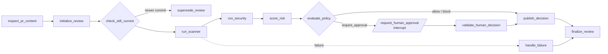

# ClearMerge

ClearMerge is a human-in-the-loop pull request review system for GitHub. When a PR is opened or updated, it runs real tests, dependency audits, and secret/vulnerability scans, turns the evidence into an explainable risk score, and enforces a merge policy (**allow / require approval / block**) as a GitHub check run.

It addresses three problems with ordinary PR review: security issues and leaked secrets slip past tired reviewers, LLM-only reviewers hallucinate findings and can be prompt-injected by the code they review, and approvals often go stale when someone pushes a new commit after sign-off.

---

## Features

### Review pipeline

Each review is a [LangGraph](https://langchain-ai.github.io/langgraph/) state machine with typed state and conditional routing:



- **Scanner stage** detects Python and Node projects and runs `pytest`, `pip-audit`, `npm test`, and `npm audit`.
- **Security stage** runs **Semgrep** (static analysis) and **Gitleaks** (secrets) and normalizes both into one finding schema.
- **Risk scoring** combines scanner, security, content-guard, and change-scope evidence into a 0–100 score with a risk level, recommendation, confidence, and written rationale.
- **Policy gate** maps the assessment to allow, require approval, or block, and publishes the result as a GitHub **Check Run** plus a PR comment.
- **Human approval** pauses the graph until an authorized reviewer approves or rejects the exact commit, from the dashboard or the API.
- **Dashboard** (React) shows the review inbox, live pipeline progress, stats, API health, manual review triggering, approval controls, and retry for failed reviews.

### System design and engineering decisions

**Deterministic enforcement, LLM as advisor only.**
Policy and scoring are plain Python (`workflow/risk.py`, `workflow/policy.py`), so every decision is reproducible and auditable. An optional LLM risk model can be injected, but `validate_risk_assessment` rejects any output that weakens the deterministic recommendation, overrides a hard block, lowers uncertainty, or raises confidence. On rejection the system falls back to the deterministic baseline. The model can add caution but never remove it.

**Real tools over LLM guessing.**
Findings come from Semgrep, Gitleaks, pytest, pip-audit, and npm, not from a model reading a diff. Tools run with `shell=False`, timeouts, and capped output, and a missing or timed-out tool becomes evidence (lower confidence, optional hard block via `required_security_tools`) instead of a silent pass.

**Explainable risk model.**
Every risk factor carries an `evidence_ref`, a severity, an impact weight, and an explanation. Thresholds are explicit (≥80 critical/block, ≥60 high/block, ≥25 medium/require approval). Hard blocks cover high-severity secrets, critical findings, stale evidence, and missing required scans. Uncertainty is computed from tool health and is shown to the approving human.

**Durable human-in-the-loop.**
Approval uses LangGraph's `interrupt` / `Command(resume=...)`, backed by a Postgres checkpointer, so a review can wait hours or days and survive restarts. The decision is checked against the reviewed commit SHA and an authorized-reviewer allow-list in the graph node, the router, and the API (`409` on mismatch).

**Stale-commit safety.**
A new push supersedes the in-flight review for that PR, and evidence tied to an old commit is a critical hard block. An approval for commit A can never merge commit B.

**Prompt-injection defense for LLM-bound content.**
PR titles, bodies, and diffs are untrusted. A content guard flags text that looks aimed at an LLM (instruction overrides, role impersonation, secret exfiltration, tool manipulation). It stores only pattern labels, never the matched text, and forces human approval (or blocks outright when a repository policy sets `block_suspicious_content`).

**Secrets never reach a model.**
`llm/safety.py` recursively replaces secret-shaped values (API keys, GitHub tokens, JWTs, AWS keys, `password=...`) with a non-reversible SHA-256 fingerprint before any payload is built, so identical secrets still correlate. Tool output goes through the same redaction, and stored finding evidence is masked.

**Secure webhook ingestion.**
`POST /webhooks/github` verifies the HMAC-SHA256 signature with a constant-time compare, enforces a body-size cap (middleware and handler), and returns `202` immediately. Handling is idempotent by delivery ID, and one active review is tracked per PR revision.

**Async work via a queue.**
In `queue` mode the API enqueues a job on Redis (`RPUSH`/`BLPOP`) and a separate worker process runs the review, retrying up to 3 times before marking it failed. The queue sits behind a `Protocol` with an in-memory implementation, and `inline` mode lets you develop without Redis.

**Isolated, ephemeral checkouts.**
Each review fetches only the exact head commit (`--depth 1`) into a temp directory and deletes it in a `finally` block. The GitHub token is passed through `GIT_CONFIG_*` environment variables, so it never appears in the clone URL, on a command line, or in `.git/config`.

**GitHub App authentication.**
Short-lived RS256 app JWTs are exchanged for installation tokens, which gives least-privilege, per-installation access with no long-lived personal token.

**Persistence and recovery.**
Review records are stored as JSONB in Postgres next to the LangGraph checkpoints, and are reloaded on startup. Without a database URL the service falls back to in-memory storage for tests and local use.

**Testable by construction.**
`build_review_graph(nodes=..., checkpointer=..., risk_model=...)` takes injectable nodes, the GitHub client is a thin boundary, and configuration is a frozen, validated dataclass whose `repr` hides secrets. The suite has 66 test functions covering risk scoring, routing, the graph, the scanner and security runners, redaction, the content guard, the queue/worker, the GitHub API, and repository checkout.

**Deployment hygiene.**
Docker Compose runs the API, worker, Postgres 16, and Redis 7 (AOF on) with health checks and `depends_on: service_healthy`. Ports bind to `127.0.0.1`, required secrets use `${VAR:?}` guards so the stack refuses to start without them, and the app image runs as a non-root user.

### API surface

| Method | Path | Purpose |
|---|---|---|
| `POST` | `/webhooks/github` | Signed GitHub `pull_request` events |
| `GET` / `POST` | `/api/reviews` | List with filters and pagination / trigger a manual review |
| `GET` | `/api/reviews/{id}` | Review state, risk assessment, pipeline stages |
| `POST` | `/api/reviews/{id}/approval` | Submit an approve or reject decision |
| `POST` | `/api/reviews/{id}/retry` | Retry a failed review |
| `GET` | `/api/stats` | Counts by decision, average risk, reviews over time |
| `GET` | `/healthz`, `/readyz` | Liveness and readiness |

### Roadmap

- Wire a Gemini client into the risk-scorer hook (`RiskModel`). The sanitization and validation guardrails are in place, and `.env.example` already reserves the model settings.
- A dedicated auditor agent. The audit trail is currently the persisted review state, the GitHub check run, and the PR comment.
- Run Semgrep and Gitleaks from the pinned scanner image in `security/` instead of the host environment.

---

## Tech stack and project structure

### Why each technology

| Technology | Role | Why it was chosen |
|---|---|---|
| **Python 3.14** | Backend, orchestration, tool runners | The security tools (Semgrep, pip-audit) and the LangGraph ecosystem are Python-native. Typed dicts and dataclasses keep the review state and tool contracts explicit. |
| **LangGraph** | Review workflow | A review is a long-running, branching process with a pause for a human. LangGraph provides conditional edges, `interrupt`/resume, and checkpointing, which would otherwise have to be built by hand. |
| **FastAPI + Pydantic** | HTTP API and webhook receiver | Async handlers, request validation, and automatic OpenAPI docs. Pydantic enforces the approval and manual-review schemas at the boundary. |
| **PostgreSQL 16** (`psycopg` 3) | Review records and graph checkpoints | Durable, transactional storage. JSONB suits evolving review state, and one database serves both the API index and the LangGraph checkpointer. |
| **Redis 7** | Job queue | A simple, fast list-based queue that decouples webhook latency from slow scans and lets workers scale independently. |
| **Semgrep + Gitleaks** | Vulnerability and secret detection | Mature, deterministic scanners. The LLM never has to guess whether code is vulnerable. |
| **Gemini (target provider)** | Optional risk-scoring assist | Planned as an advisor behind a validated hook, with `gemini-2.5-flash` configured for the scanner, security, and risk-scorer roles. |
| **httpx + PyJWT** | GitHub App client | Lightweight HTTP and RS256 signing for app-JWT → installation-token auth. |
| **TypeScript + React 19 + Vite 7** | Dashboard | Typed API client and components catch contract drift with the backend. Vite gives fast dev builds and an `/api` proxy. |
| **Docker + Compose** | Packaging and local infrastructure | One command brings up the API, worker, Postgres, and Redis. A separate pinned image holds the scanners. |

### Project structure

```
clearmerge/
├── backend/clearmerge/
│   ├── api/            # FastAPI app factory, webhook endpoint, review/approval/stats routes
│   ├── workflow/       # LangGraph graph, typed state, routing, risk scoring, policy, content guard
│   ├── scanner/        # Test and dependency-audit agent and subprocess runner
│   ├── security/       # Semgrep and Gitleaks agent and finding normalization
│   ├── llm/            # Secret redaction applied before anything reaches a model
│   ├── github/         # GitHub App client, signature check, PR event model, checkout adapter
│   ├── services/       # Review service, Redis/in-memory queue, worker loop, Postgres store
│   ├── config.py       # Validated, env-driven settings (secrets hidden from repr)
│   └── worker.py       # Entrypoint for the queue worker process
├── frontend/           # React + TypeScript + Vite dashboard
├── security/           # Dockerfile for pinned Semgrep + Gitleaks image
├── tests/              # Unit tests for risk, routing, graph, scanners, queue, GitHub API
├── Dockerfile          # Non-root API/worker image
├── docker-compose.yml  # api, worker, postgres, redis
└── .env.example        # Configuration template
```

The layout separates **evidence gathering** (`scanner`, `security`), **decision logic** (`workflow`), **I/O boundaries** (`github`, `api`, `services`), and **safety** (`llm`). Each can be tested or swapped on its own, and the decision logic has no network or database dependencies.

---

## Getting started

```bash
cp .env.example .env              # set POSTGRES_PASSWORD and the GitHub App values
docker compose up --build         # API on http://127.0.0.1:8000

cd frontend && npm install && npm run dev   # dashboard; /api is proxied to :8000

pip install -r requirements.txt
python -m unittest discover -s tests        # run the tests
```

Point your GitHub App's webhook at `/webhooks/github` and set `GITHUB_WEBHOOK_SECRET`, `GITHUB_APP_ID`, a private key, `GITHUB_INSTALLATION_ID`, and `AUTHORIZED_REVIEWER_IDS` in `.env`. Never commit `.env`; it is git-ignored.
